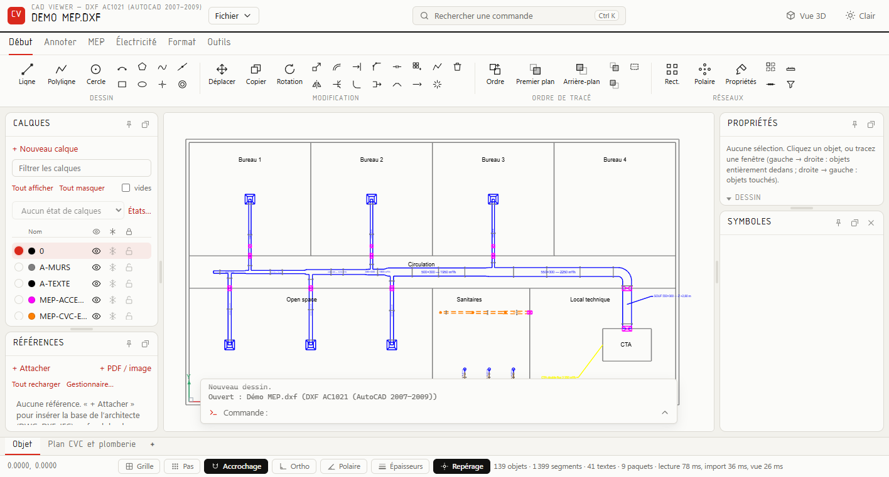
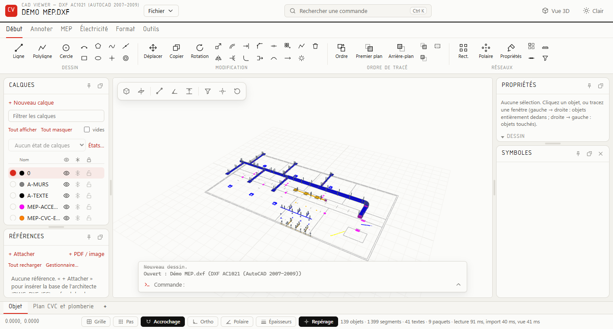
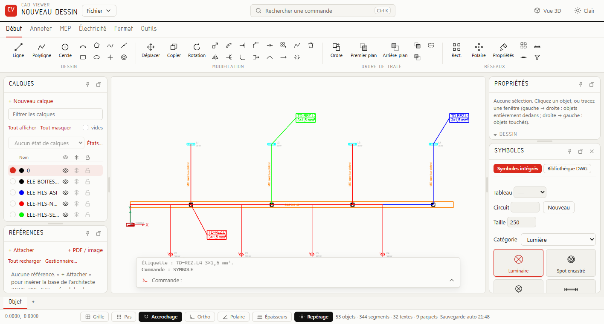
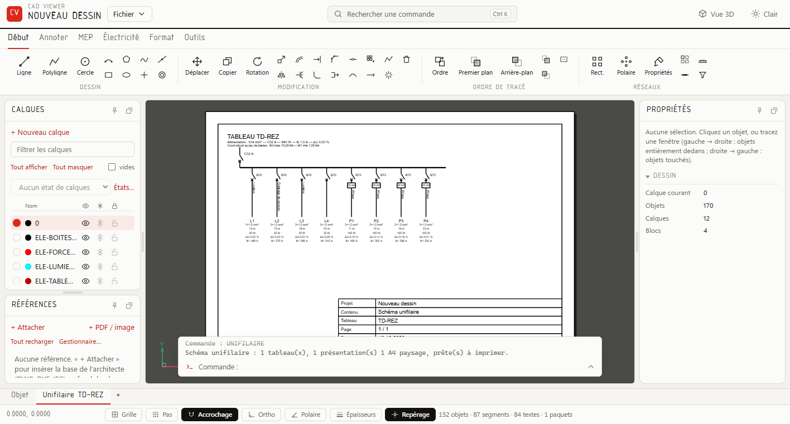

# CAD Viewer

Éditeur de plans **DWG / DXF** dans le navigateur, pensé pour les projets techniques du bâtiment : ventilation,
sanitaire, chauffage et électricité. Rapide même sur de gros fichiers, il fonctionne hors ligne.

## Ce qu'il sait faire

- **Dessin 2D** : dessin et modification, calques, blocs, cotes, hachures, présentations et impression PDF.
- **MEP** : gaines, canalisations, chemins de câbles et tubes ; débits, dimensionnement, pertes de charge, métré et
  détection des conflits.
- **Électricité** : symboles, tableaux et circuits, bilan de puissance, sections, courts-circuits, cheminement des
  câbles, étiquettes et schémas unifilaires prêts à imprimer.
- **Coordination** : fonds de plan d'architecte (DWG, DXF, IFC), vue 3D avec coupes et mesures, export IFC et BCF.

| Vue 3D | Électricité | Schéma unifilaire |
|---|---|---|
|  |  |  |

## Installation

- **Windows** : télécharger `CAD-Viewer-Setup-<version>.exe` dans les [Releases](../../releases) et le lancer
  (sans droits d'administrateur).
- **Autres systèmes** (ou depuis les sources) : avec Python 3, lancer `python serve.py` dans le dossier du projet,
  puis ouvrir <http://localhost:8000>.

Un dessin d'exemple est fourni : menu **Fichier › Exemples… › Démo MEP**.

## Développement

- Sans compilation : une page HTML, des modules JavaScript (`src/`) et un petit serveur Python (`serve.py`).
  Bibliothèques dans `vendor/` (`python -I scripts/vendor.py` pour les retélécharger).
- Tests : <http://localhost:8000/tests/index.html>.
- Version Windows : `python -I scripts/build_exe.py <version>` puis `python -I scripts/build_installer.py <version>`
  (PyInstaller).
- Suite prévue : [ROADMAP.md](ROADMAP.md).

## Licence

Copyright © 2026 JujuH et contributeurs — **GPL-3.0-or-later** ([LICENSE](LICENSE)), sans aucune garantie.
Composants tiers et leurs licences : [THIRD-PARTY.md](THIRD-PARTY.md).

## À savoir

- **Calculs indicatifs** : les résultats (électricité, débits, dimensionnement…) reposent sur des valeurs générales
  et doivent être vérifiés par un professionnel selon les normes en vigueur.
- **Projet indépendant**, sans lien avec les éditeurs de logiciels ou les fabricants cités dans l'application ; leurs
  noms et marques appartiennent à leurs propriétaires.
- **Confidentialité** : aucune donnée n'est envoyée sur Internet. Les dessins enregistrés contiennent les chemins
  des fichiers liés (fonds de plan, références).
- **Sécurité** : le serveur local n'écoute que sur 127.0.0.1 et ne doit pas être exposé sur un réseau. Merci de
  signaler une faille en privé plutôt que dans un ticket public.
