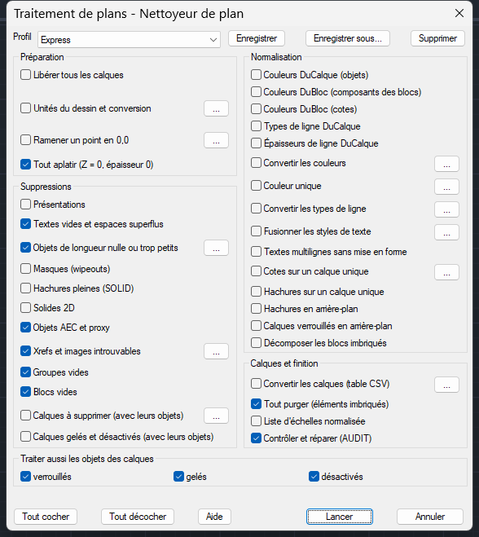

# Traitement de plans pour AutoCAD LT

Module de nettoyage et de normalisation de plans d’architecte (fonds de plan), écrit entièrement en AutoLISP + DCL.

- **Compatibilité** : AutoCAD LT 2024 et suivants, et AutoCAD complet.
- **Dépendances** : aucune. Ni .NET, ni ActiveX, ni Express Tools.
- **Installation** : un seul fichier à installer, `TraitementPlans.lsp`.

## Installation

1. Copier `TraitementPlans.lsp` dans un dossier fixe, par exemple `C:\CAD\Lisp`.
2. Dans AutoCAD LT, commande **APPLOAD** :
   - choisir le fichier, puis **Charger** ;
   - pour un chargement automatique à chaque dessin : **Valise de démarrage** → **Contenu…** → **Ajouter**.
3. Facultatif, pour éviter l'avertissement de sécurité : **OPTIONS** → **Fichiers** → **Emplacements approuvés** → ajouter le dossier.

Au chargement, la ligne de commande affiche : `Traitement de plans 1.0 chargé`.

## Commandes

| Commande | Rôle |
|---|---|
| **TP** | Boîte de dialogue « Nettoyeur de plan » : cases à cocher, réglages, profils |
| **TPEXPRESS** | Nettoyage rapide avec le profil « Express », sans dialogue |
| **TPPROFIL** | Lance un profil choisi par son nom (utile dans les scripts) |
| **TPLOT** | Traite tous les dessins d'un dossier avec un profil |
| **TPTABLECALQUES** | Crée la table des calques du dessin (CSV pour Excel) |
| **TPCALQUES** | Convertit les calques d'après une table CSV |
| **TPPURGE** | Purge complète, éléments imbriqués compris, puis contrôle (AUDIT) |
| **TPLIBERER** | Dégèle, active et déverrouille tous les calques |
| **TPAPLATIR** | Met tout à Z = 0, blocs compris |
| **TPORIGINE** | Ramène un point désigné en 0,0 |
| **TPNEXPL** | Décompose les blocs imbriqués |
| **TPDOSSIER** | Change le dossier des profils (par exemple un dossier réseau partagé) |
| **TPAIDE** | Aide |

**Annulation** : tout traitement s'annule d'un seul **U**.

## Le nettoyeur (commande TP)

### Préparation
- Libérer tous les calques.
- Unités du dessin, avec mise à l'échelle depuis une autre unité :
  - exemple : une base en centimètres mise en millimètres est agrandie 10 fois ;
  - le bouton **Mesurer** aide à reconnaître l'unité d'un plan.
- Ramener un point en 0,0.
- Tout aplatir (Z = 0, épaisseur 0).

### Suppressions
- Présentations.
- Textes vides et espaces superflus.
- Objets de longueur nulle ou plus courts qu'une tolérance.
- Masques (wipeouts).
- Hachures pleines. Celles d'un import PDF sont gardées, car elles dessinent aussi les textes.
- Solides 2D.
- Objets AEC et proxy (exports d'AutoCAD Architecture / MEP).
- Xrefs et images introuvables ou non référencées, ou bien liaison des xrefs trouvées dans le dessin.
- Groupes vides et blocs vides.
- Calques choisis, avec leurs objets.
- Calques gelés ou désactivés, avec leurs objets.

### Normalisation
- Couleurs DuCalque (objets) ou DuBloc (composants des blocs, cotes).
- Types et épaisseurs de ligne DuCalque.
- Table de conversion des couleurs, ou couleur unique.
- Conversion des types de ligne.
- Fusion des styles de texte et police unique.
- Textes multilignes sans couleurs, polices, soulignés ni masques. Les hauteurs relatives sont gardées.
- Cotes et hachures sur un calque unique.
- Hachures et calques verrouillés en arrière-plan.
- Décomposition des blocs imbriqués :
  - les composants du calque 0 et DuBloc prennent les propriétés de la référence ;
  - les attributs deviennent des textes.

### Calques et finition
- Table de conversion des calques (CSV).
- Purge complète.
- Liste d'échelles normalisée, adaptée à l'unité du dessin.
- AUDIT.

En bas du dialogue, « Traiter aussi les objets des calques verrouillés / gelés / désactivés » indique si les objets de ces calques sont touchés. Les calques retrouvent leur état à la fin, sauf si « Libérer tous les calques » est coché.

Le rapport s'affiche à la fin, en ligne de commande : nombre d'objets supprimés, modifiés, de blocs redéfinis, avertissements.

## Profils

Un profil est un jeu de cases et de réglages. Les boutons **Enregistrer**, **Enregistrer sous…** et **Supprimer** se trouvent en haut du dialogue.

Trois profils sont créés au premier lancement :

| Profil | Pour quoi faire |
|---|---|
| **Express** | Nettoyage sans changement d'aspect : textes vides, objets nuls, proxy, xrefs introuvables, groupes et blocs vides, aplatir, purger, AUDIT |
| **Base architecte** | Express + présentations, masques, hachures pleines, mise en forme des textes, hachures en arrière-plan, xrefs non référencées. Les couleurs de l'architecte sont gardées |
| **Fond de plan gris** | Base architecte + tous les calques en couleur 8, objets DuCalque, composants des blocs et cotes DuBloc, épaisseurs DuCalque |

**Stockage** : chaque profil est un petit fichier texte `.tpp`, dans `%APPDATA%\TraitementPlans` par défaut.

**Partage avec les collègues** : **TPDOSSIER** permet d'utiliser un dossier réseau commun.

## Convertir les calques d'une base architecte

1. Ouvrir la base, lancer **TPTABLECALQUES**. Un fichier `… - calques.csv` est créé, avec tous les calques et leur nombre d'objets.
2. L'ouvrir dans Excel et remplir la colonne **Calque cible** :
   - **un nom** : les objets passent sur ce calque, créé au besoin avec la couleur, le type de ligne et l'épaisseur indiqués ;
   - **vide** : calque inchangé ;
   - **SUPPRIMER** : les objets du calque sont supprimés.
3. Enregistrer (CSV avec séparateur point-virgule, ou CSV UTF-8).
4. Lancer **TPCALQUES**, ou cocher « Convertir les calques » dans le profil, avec le chemin de la table.

**Motifs dans la source** : `*` et `?` sont autorisés (`A-WALL*`, `*MOBILIER*`). La première ligne qui correspond l'emporte : mettre les motifs les plus précis en haut.

**Réutilisation** : la même table resservira pour chaque nouvelle version de la base, puisque les noms de calques de l'architecte ne changent pas.

**Exemple** : `exemples\Table calques - exemple.csv`.

## Traitement par lot (TPLOT)

1. Choisir un dessin du dossier, puis le profil.
2. Choisir l'enregistrement :
   - **Copie** (défaut) : dans un sous-dossier `Traité` ;
   - **Remplacer** : les fichiers d'origine sont écrasés.

Le rapport de chaque dessin est ajouté à `Traitement de plans - rapport.txt`, dans le dossier traité.

Au premier lancement, TPLOT demande où se trouve `TraitementPlans.lsp` s'il n'est pas dans un dossier de recherche d'AutoCAD.

## Limites connues

- **Blocs dynamiques** :
  - leurs définitions ne sont jamais redéfinies, pour ne pas casser les paramètres et actions ;
  - un objet à supprimer y est rendu invisible (le rapport le signale) ;
  - même règle pour les blocs anonymes (`*U…`).
- **Repères multiples (MLEADER) et tableaux** : leur contenu n'est pas modifié.
- **Unités** : la mise à l'échelle n'adapte pas les présentations. Il vaut mieux supprimer les présentations d'une base architecte.
- **Présentations** : avec certains fichiers, AutoCAD laisse des blocs anonymes orphelins quand on les supprime ; un AUDIT les signale ensuite. C'est le comportement de la commande `-LAYOUT` d'AutoCAD elle-même, et ces blocs sont sans conséquence.
- **Encodage** : le fichier est en UTF-8, la norme depuis AutoCAD 2021. Sur un AutoCAD complet réglé avec `LISPSYS = 0`, les accents s'afficheraient mal.

## Pour le développement

- **Sources** :
  - `src/traitement-plans.lsp` : le code ;
  - `src/dialogues.dcl` : les boîtes de dialogue.
- **Assemblage** : `python build.py` produit `TraitementPlans.lsp`. Il contrôle au passage :
  - l'équilibre des parenthèses ;
  - les fonctions absentes d'AutoCAD LT ;
  - la syntaxe DCL et la cohérence des clés entre le code et les dialogues.
- **Tests** : `python tests/run_tests.py` lance 114 vérifications dans AutoCAD 2024 sans interface (accoreconsole).
- **Essai sur un vrai plan** : `tests/reel.lsp`.
